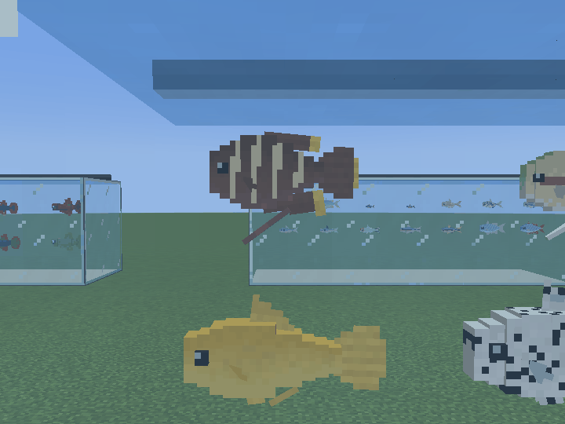

---
navigation:
  title: Chocolate Gourami
  icon: bettacraft:chocolate_gourami_bucket
  parent: tankmates/gouramis.md
  position: 30
item_ids:
  - bettacraft:chocolate_gourami_bucket
  - bettacraft:chocolate_gourami_spawn_egg
---

# Chocolate Gourami

A small, shy gourami: chocolate brown with cream bands and yellow-edged fins; one of the most delicate aquarium fish.

**Origin:** the peat swamps of Malaysia, Sumatra and Borneo.

## Profile

| | |
|---|---|
| Group | Gouramis |
| Scientific name | *Sphaerichthys osphromenoides* |
| Size in the game | about 5.5 cm (0.45 blocks) |
| Temperature | 25–30 °C |
| Breeding temperature | 27–29 °C |
| Water | fresh water, sensitive |
| Water chemistry | pH 4.5–7.0, TDS 0–200 ppm |
| Shoal | from 4 fish |
| Swims | in the middle |
| Stocking | counts as 0.5 fish |
| Breeding | Mouthbrooder, 10–25 young |
| Betta tank | yes |
| Special | breathes air (labyrinth fish) |

## Breeding

A **mouthbrooder**: at 27–29 °C a female spawns with a male and takes the eggs into her mouth; after 3 days (like the livebearers, `tankmates.gestationDays`) she spits out 10–25 free-swimming young. No breeding box needed, but the other fish eat the young: plants hide them.

## Keeping

* **Labyrinth fish:** breathes air at the surface like a betta, so it copes with still water and little oxygen.
* **Only very soft, acid water** (pH 4.5–7, TDS up to 200): peat and almond leaves (see [water chemistry](../aquarium/water_chemistry.md)); tap water stresses it.
* A calm group of 4 or more; warm (25–30 °C), very clean water.

## Obtaining

* **[Aquarium net](../equipment/tank_net.md)** in swamps: 0.3–0.35 % per swing (about 1 in 282–334 swings), 1–4 at a time.
* **[Aquarium net](../equipment/tank_net.md)** in jungle water: 0.13–0.16 % per swing (about 1 in 631–748 swings), 1–4 at a time.
* **Wild** in swamps, in groups of 3–4 (spawn weight 2) (config `features.tankmates.gouramis`).
* **Wild** in jungle water, in groups of 3–4 (spawn weight 2) (config `features.tankmates.gouramis`).
* **Wandering trader** (rare offers): 6 for 7 emeralds; one of 12 in this offer.
* **[Breeding](breeding.md)**: Mouthbrooder.

The biomes of biome mods count too ([biome tags](../settings.md)).
