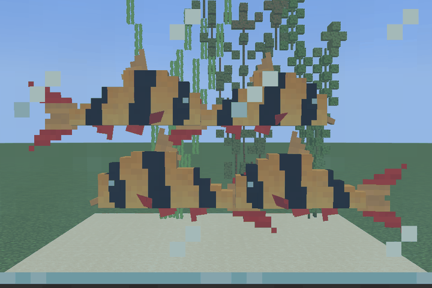

---
navigation:
  title: Clown Loach
  icon: bettacraft:clown_loach_bucket
  parent: tankmates/loaches.md
  position: 20
item_ids:
  - bettacraft:clown_loach_bucket
  - bettacraft:clown_loach_spawn_egg
---

# Clown Loach

Orange with three black bands, gets big, wants a group and eats snails. Does not breed in tanks.

**Origin:** the rivers of Borneo and Sumatra.

## Profile

| | |
|---|---|
| Group | Loaches |
| Scientific name | *Chromobotia macracanthus* |
| Size in the game | about 11 cm (0.9 blocks) |
| Temperature | 25–30 °C |
| Water | fresh water, sensitive |
| Shoal | from 5 fish |
| Swims | in the lower water |
| Stocking | counts as 2.5 fish |
| Breeding | Does not breed in a tank |
| Betta tank | too big |
| Special | eats snails |

## Breeding

Practically never breeds in a tank.

## Keeping

* Bottom fish: gets only part of the sinking food while faster fish are around - algae wafers go straight to it.
* Eats snails (not the big apple snails).

## Obtaining

* **[Aquarium net](../equipment/tank_net.md)** in swamps: 0.5–0.6 % per swing, 1–4 at a time.
* **[Aquarium net](../equipment/tank_net.md)** in jungle water: 0.2–0.24 % per swing, 1–4 at a time.
* **Wandering trader** (rare offers): 6 for 17 emeralds; one of 5 in this offer.
