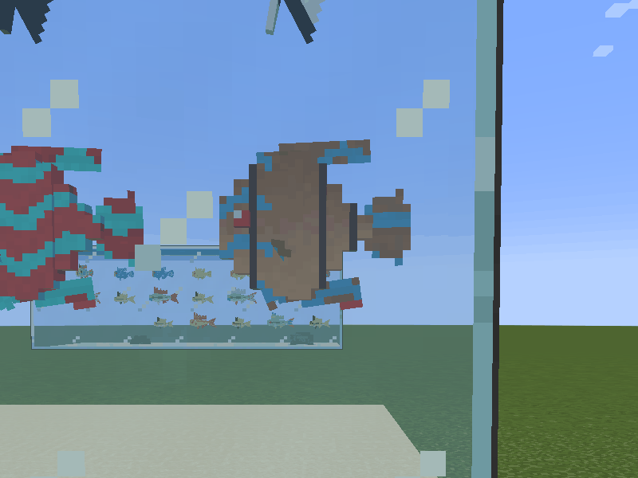

---
navigation:
  title: Discus
  icon: bettacraft:discus_bucket
  parent: tankmates/cichlids.md
  position: 60
item_ids:
  - bettacraft:discus_bucket
  - bettacraft:discus_spawn_egg
---

# Discus

The king of the aquarium: a round, flat disc, brown with nine faint bars and blue lines in the wild, bred in bright colours.

**Origin:** the warm, very soft water of the Amazon.

## Profile

| | |
|---|---|
| Group | Cichlids |
| Scientific name | *Symphysodon aequifasciatus* |
| Size in the game | about 11.5 cm (0.95 blocks) |
| Temperature | 27–32 °C |
| Breeding temperature | 28–31 °C |
| Water | fresh water, sensitive |
| Water chemistry | pH 5.0–7.0, TDS 0–200 ppm |
| Shoal | from 3 fish |
| Swims | in the middle |
| Stocking | counts as 2.5 fish |
| Breeding | Open brooder: the pair spawns on a stone, leaf or the glass and guards the brood, 20–60 young |
| Betta tank | too warm |
| Special | guards its brood, feeds its young with skin secretion, 4 colour varieties |

## Varieties

Varieties: Wild type (brown), Red Turquoise, Pigeon Blood, Blue Diamond. The wild type is dominant, the bred varieties are recessive: only two equal alleles show the colour (carriers look wild). Of two different bred varieties the one listed first shows. Wild fish now and then carry a bred variety hidden; the menu shows the genes in a tooltip.

## Breeding

At 28–31 °C a pair forms: the male and the nearest free female clean a **broad leaf** or else **the glass** and spawn 20–60 eggs there. Both parents stay at the brood, fan the eggs and **drive every other fish away** (bettas too: the intruder flees and takes a bite, config `tankmates.behaviour.broodDefence`). Guarded eggs are safe from the other fish; when both parents are gone, the brood dies.

The young **feed on the skin secretion of their parents**: they stay with them more than two days longer than other cichlid young and die when the parents are taken out.

## Keeping

* Warm (27–32 °C, best 30 °C) and very soft, acidic water (pH 5–7, TDS up to 200 ppm); very sensitive to bad water.
* Keep a group of 3 or more. Big (counts 2.5 fish): one fits in a bucket or fish bag.

## Obtaining

* **[Aquarium net](../equipment/tank_net.md)** in jungle water: 0.09–0.11 % per swing (about 1 in 947–1121 swings), 1–4 at a time.
* **Wild** in jungle water, in groups of 3–3 (spawn weight 1) (config `features.cichlids`).
* **Wandering trader** (rare offers): 6 for 17 emeralds; one of 12 in this offer.
* **[Breeding](breeding.md)**: Open brooder: the pair spawns on a stone, leaf or the glass and guards the brood.

The biomes of biome mods count too ([biome tags](../settings.md)).
