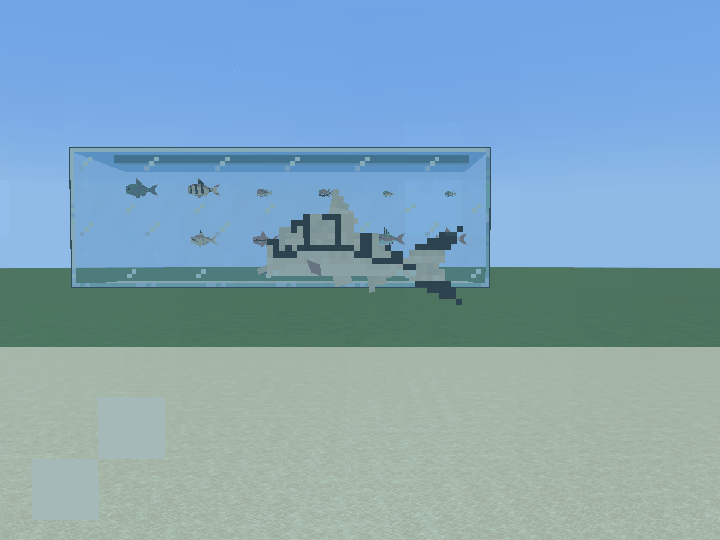

---
navigation:
  title: Dwarf Chain Loach
  icon: bettacraft:dwarf_chain_loach_bucket
  parent: tankmates/loaches.md
  position: 30
item_ids:
  - bettacraft:dwarf_chain_loach_bucket
  - bettacraft:dwarf_chain_loach_spawn_egg
---

# Dwarf Chain Loach

A small, sociable loach, pale with a chain of dark links along the side and back; swims in the open more than other loaches.

**Origin:** the rivers of Thailand and Laos.

## Profile

| | |
|---|---|
| Group | Loaches |
| Scientific name | *Ambastaia sidthimunki* |
| Size in the game | about 5 cm (0.42 blocks) |
| Temperature | 24–29 °C |
| Water | fresh water, normal |
| Water chemistry | pH 6.0–8.0, TDS 0–550 ppm |
| Shoal | from 6 fish |
| Swims | in the lower water |
| Stocking | counts as 0.4 fish |
| Breeding | Does not breed in a tank |
| Betta tank | yes |
| Special | eats snails |

## Breeding

Practically never breeds in a tank.

## Keeping

* Eats snails (not the big apple snails; `tankmates.behaviour.clownLoachSnailsPerDay`).
* Bottom fish: gets only part of the sinking food while faster fish are around - algae wafers go straight to it.
* In a group of 6 or more; fine with a betta.

## Obtaining

* **[Aquarium net](../equipment/tank_net.md)** in rivers: 0.36–0.42 % per swing (about 1 in 238–281 swings), 1–4 at a time.
* **Wild** in rivers, in groups of 3–6 (spawn weight 2) (config `features.barbsAndLoaches`).
* **Wandering trader** (rare offers): 6 for 7 emeralds; one of 12 in this offer.

The biomes of biome mods count too ([biome tags](../settings.md)).
