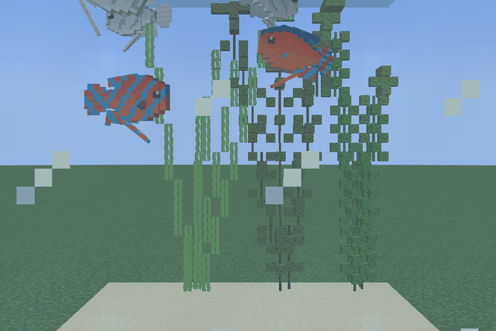

---
navigation:
  title: Dwarf Gourami
  icon: bettacraft:dwarf_gourami_bucket
  parent: tankmates/gouramis.md
  position: 10
item_ids:
  - bettacraft:dwarf_gourami_bucket
  - bettacraft:dwarf_gourami_spawn_egg
---

# Dwarf Gourami

Blue and red striped males with long feelers; a labyrinth fish like the betta - male gouramis and male bettas fight.

**Origin:** plant-rich waters of India and Bangladesh.

## Profile

| | |
|---|---|
| Group | Gouramis |
| Scientific name | *Trichogaster lalius* |
| Size in the game | about 6.5 cm (0.55 blocks) |
| Temperature | 24–29 °C |
| Breeding temperature | 26–29 °C |
| Water | fresh water, normal |
| Water chemistry | pH 6.0–8.0, TDS 0–500 ppm |
| Shoal | alone or as a pair |
| Swims | near the surface |
| Stocking | counts as 1 fish |
| Breeding | Builds a foam nest, 20–50 young |
| Betta tank | no |
| Special | breathes air (labyrinth fish), territorial, chased by male bettas, 3 colour varieties |

## Varieties

Varieties: Wild type (blue and red), Powder Blue, Flame. The wild type is dominant, the bred varieties are recessive: only two equal alleles show the colour (carriers look wild). Of two different bred varieties the one listed first shows. Wild fish now and then carry a bred variety hidden; the menu shows the genes in a tooltip.

## Breeding

Like a betta: at 26–29 °C the male builds a foam nest at the surface (floating plants help), the female spawns 20–50 eggs into it, then the male chases her away and guards the nest.

## Keeping

* Male bettas go for the males of this species (config `tankmates.behaviour.bettaAggression`).

## Obtaining

* **[Aquarium net](../equipment/tank_net.md)** in swamps: 1–1.2 % per swing (about 1 in 85–100 swings).
* **Wild** in swamps, alone (spawn weight 5) (config `features.tankmates.wildSpawns`).
* **Wandering trader** (usual offers): 2 for 4 emeralds; one of 36 in this offer.
* **[Aquarist villager](../getting_started/aquarist.md)** (Master): 2 for 14 emeralds; one of about 14 in this offer (config `features.tankmates.wildSpawns`).
* **[Breeding](breeding.md)**: Builds a foam nest.

The biomes of biome mods count too ([biome tags](../settings.md)).
