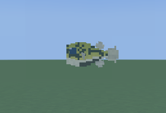

---
navigation:
  title: Dwarf Puffer
  icon: bettacraft:dwarf_puffer_bucket
  parent: tankmates/puffers.md
  position: 10
item_ids:
  - bettacraft:dwarf_puffer_bucket
  - bettacraft:dwarf_puffer_spawn_egg
---

# Dwarf Puffer

The smallest puffer (also pea puffer): yellow-green with dark blotches, big eyes that move on their own; the male has a dark line along the belly.

**Origin:** the rivers and lakes of Kerala and Karnataka in south-west India.

## Profile

| | |
|---|---|
| Group | Puffers |
| Scientific name | *Carinotetraodon travancoricus* |
| Size in the game | about 2.5 cm (0.22 blocks) |
| Temperature | 22–29 °C |
| Breeding temperature | 25–28 °C |
| Water | fresh water, normal |
| Water chemistry | pH 6.5–8.2, TDS 50–600 ppm |
| Shoal | alone or as a pair |
| Swims | in the middle |
| Stocking | counts as 0.4 fish |
| Breeding | Scatters its eggs (fine plants, spawning mop), 5–15 young |
| Betta tank | no (nips fins) |
| Special | eats snails, needs snails or hard food for its teeth, nips long fins |

## Breeding

At 25–28 °C a pair scatters 5–15 eggs into fine-leaved plants, java moss or a **spawning mop**. The parents and every other fish eat the eggs they reach; in a spawning mop most are safe. Live food gets them ready faster.

## Keeping

* **Eats snails:** about one snail a day (`tankmates.behaviour.pufferSnailsPerDay`), the bladder and ramshorn snails first; not the big apple snails, nerites seldom. A puffer is the cure for a snail plague, and a small snail tank feeds it.
* **Teeth:** a puffer's beak-like teeth never stop growing. Cracking snails or [shell food](../food/food_variety.md) wears them down; after 8 days without either (config `tankmates.behaviour.pufferTeethDays`) they have overgrown: the puffer is stressed and refuses all soft food until it gets a snail or shell food again.
* **Fin nipper:** goes for the long fins of bettas, angelfish, gouramis and male guppies: they flee, are stressed and lose hit points (`tankmates.behaviour.finNipping`). Not with bettas.
* Alone or as a small species group in a planted tank; it hunts its tankmates' fry and shrimplets.

## Obtaining

* **[Aquarium net](../equipment/tank_net.md)** in rivers: 0.44–0.53 % per swing (about 1 in 190–225 swings).
* **[Aquarium net](../equipment/tank_net.md)** in swamps: 0.3–0.35 % per swing (about 1 in 282–334 swings).
* **Wild** in rivers, alone (spawn weight 3) (config `features.tankmates.puffers`).
* **Wild** in swamps, alone (spawn weight 2) (config `features.tankmates.puffers`).
* **Wandering trader** (usual offers): 2 for 3 emeralds; one of 36 in this offer.
* **[Breeding](breeding.md)**: Scatters its eggs (fine plants, spawning mop).

The biomes of biome mods count too ([biome tags](../settings.md)).
