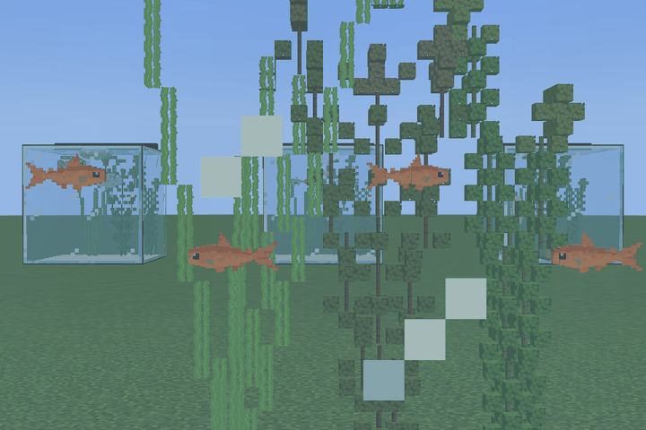

---
navigation:
  title: Ember Tetra
  icon: bettacraft:ember_tetra_bucket
  parent: tankmates.md
  position: 12
item_ids:
  - bettacraft:ember_tetra_bucket
  - bettacraft:ember_tetra_spawn_egg
---

# Ember Tetra

A tiny, glowing orange tetra, peaceful and good with bettas.

| | |
|---|---|
| Family | Tetras |
| Scientific | *Hyphessobrycon amandae* |
| Size in the game | about 2 cm (0.17 blocks) |
| Origin | the Araguaia basin in Brazil |
| Temperature | 22–29 °C |
| Shoal | 6 or more |
| Water | sensitive |
| Stocking | 0.2 fish |
| Breeding | Scatters its eggs (fine plants, spawning mop), 25–28 °C |

## Breeding

At 25–28 °C a pair scatters 15–40 eggs into fine-leaved plants, java moss or a **spawning mop**. The parents and every other fish eat the eggs they reach; in a spawning mop most are safe. Live food (mosquito larvae) gets them ready faster.

## Getting it

With the [aquarium net](../invertebrates/catching.md) in jungle water and from the wandering trader; then by breeding.
