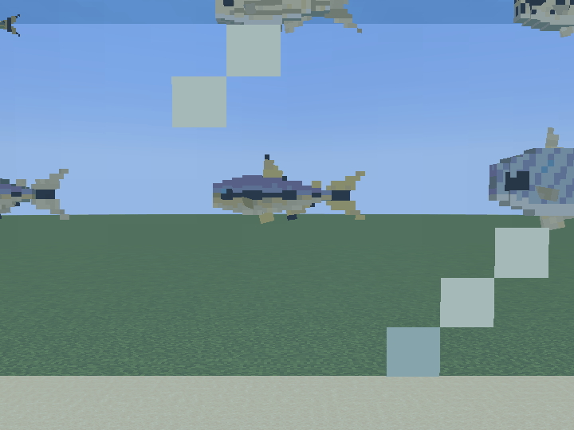

---
navigation:
  title: Emperor Tetra
  icon: bettacraft:emperor_tetra_bucket
  parent: tankmates/tetras.md
  position: 60
item_ids:
  - bettacraft:emperor_tetra_bucket
  - bettacraft:emperor_tetra_spawn_egg
---

# Emperor Tetra

A broad black band along the side, a violet-blue sheen above and gold below, yellow fins edged black; the male has blue eyes and longer fins.

**Origin:** the rivers of the Chocó in western Colombia.

## Profile

| | |
|---|---|
| Group | Tetras |
| Scientific name | *Nematobrycon palmeri* |
| Size in the game | about 5 cm (0.42 blocks) |
| Temperature | 23–27 °C |
| Breeding temperature | 24–27 °C |
| Water | fresh water, normal |
| Water chemistry | pH 5.0–7.8, TDS 0–450 ppm |
| Shoal | from 6 fish |
| Swims | in the middle |
| Stocking | counts as 0.45 fish |
| Breeding | Scatters its eggs (fine plants, spawning mop), 20–50 young |
| Betta tank | too cool |

## Breeding

At 24–27 °C a pair scatters 20–50 eggs into fine-leaved plants, java moss or a **spawning mop**. The parents and every other fish eat the eggs they reach; in a spawning mop most are safe. Live food gets them ready faster.

## Keeping

* Soft water, 23–27 °C: a bit too cool for a classic betta tank.

## Obtaining

* **[Aquarium net](../equipment/tank_net.md)** in rivers: 0.36–0.42 % per swing (about 1 in 238–281 swings), 1–4 at a time.
* **[Aquarium net](../equipment/tank_net.md)** in jungle water: 0.18–0.21 % per swing (about 1 in 473–561 swings), 1–4 at a time.
* **Wild** in rivers, in groups of 3–6 (spawn weight 2) (config `features.communityFish`).
* **Wild** in jungle water, in groups of 3–6 (spawn weight 2) (config `features.communityFish`).
* **Wandering trader** (usual offers): 6 for 4 emeralds; one of 36 in this offer.
* **[Breeding](breeding.md)**: Scatters its eggs (fine plants, spawning mop).

The biomes of biome mods count too ([biome tags](../settings.md)).
