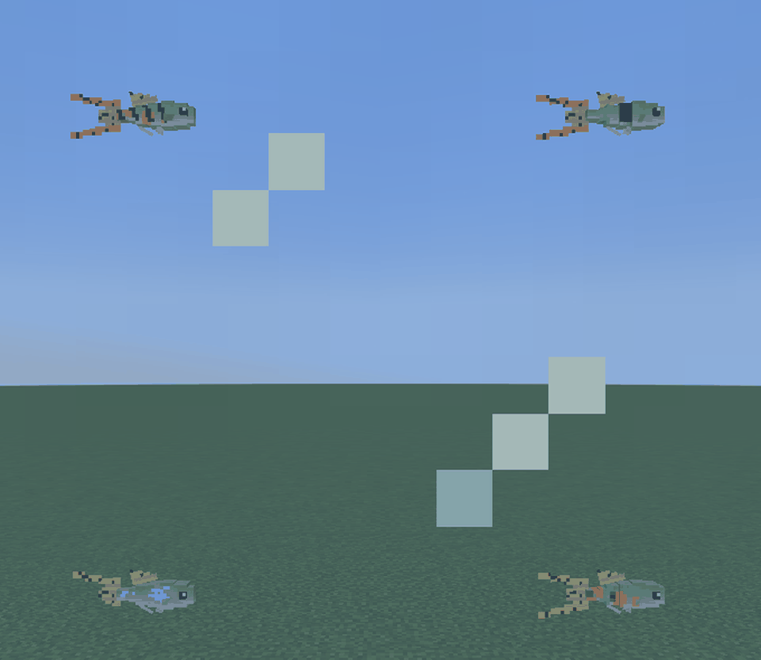

---
navigation:
  title: Endler Guppy
  icon: bettacraft:endler_guppy_bucket
  parent: tankmates/livebearers.md
  position: 20
item_ids:
  - bettacraft:endler_guppy_bucket
  - bettacraft:endler_guppy_spawn_egg
---

# Endler Guppy

Smaller than the guppy, males with neon-green and orange patches. Fine with bettas in most cases.

**Origin:** the Laguna de Patos in Venezuela.

## Profile

| | |
|---|---|
| Group | Livebearers |
| Scientific name | *Poecilia wingei* |
| Size in the game | about 2.5 cm (0.22 blocks) |
| Temperature | 23–30 °C |
| Breeding temperature | 24–29 °C |
| Water | fresh or brackish water, hardy |
| Water chemistry | pH 6.8–8.6, TDS 100–800 ppm |
| Shoal | from 3 fish |
| Swims | near the surface |
| Stocking | counts as 0.22 fish |
| Breeding | Bears live young, 4–12 young |
| Betta tank | yes |
| Special | 3 colour varieties |

## Genetics and strains

Endlers have their own alleles: peacock (the wild type), tiger, black bar and japan blue on the Y chromosome (from the
father to his sons only), swords, orange or yellow tails with coloured edges. Strains: Endler Wild Type, Tiger, Black
Bar, Japan Blue, Yellow Tail. They cross with guppies, the young are hybrids. Everything about it:
[Guppy Genetics](guppy_genetics.md).

With `features.tankmates.livebearerGenetics` off the old fixed varieties show: Wild type, Tiger, Black Bar.

## Breeding

At 24–29 °C a female with a male gets pregnant and gives birth to 4–12 young after 3 days. The adults eat fry: plants hide them, a **breeding box** in the tank catches them.

## Obtaining

* **[Aquarium net](../equipment/tank_net.md)** in rivers: 0.53–0.63 % per swing (about 1 in 158–188 swings), 1–4 at a time.
* **[Aquarium net](../equipment/tank_net.md)** in jungle water: 0.18–0.21 % per swing (about 1 in 473–561 swings), 1–4 at a time.
* **Wild** in rivers, in groups of 3–3 (spawn weight 3) (config `features.tankmates.wildSpawns`).
* **Wild** in jungle water, in groups of 3–3 (spawn weight 2) (config `features.tankmates.wildSpawns`).
* **Wandering trader** (usual offers): 6 for 3+ emeralds; one of 36 in this offer.
* **[Breeding](breeding.md)**: Bears live young.

The biomes of biome mods count too ([biome tags](../settings.md)).
