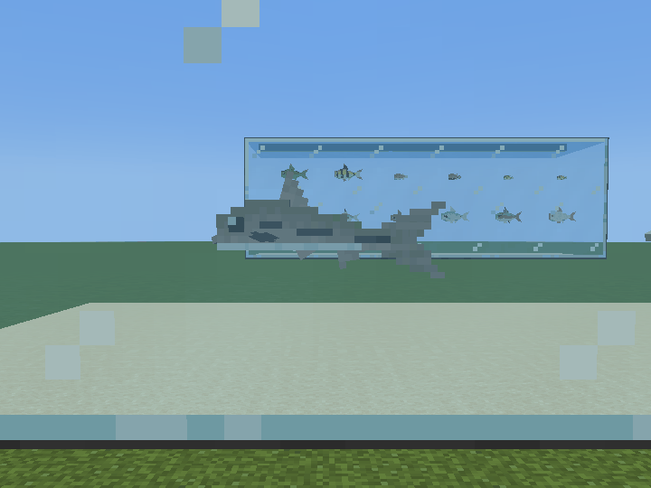

---
navigation:
  title: Garra
  icon: bettacraft:garra_rufa_bucket
  parent: tankmates/loaches.md
  position: 50
item_ids:
  - bettacraft:garra_rufa_bucket
  - bettacraft:garra_rufa_spawn_egg
---

# Garra

The "doctor fish": grey-brown with a darker stripe and a sucker disc under the mouth that holds it on stones in fast water.

**Origin:** rivers and warm springs of Turkey, Syria, Iraq and Iran.

## Profile

| | |
|---|---|
| Group | Loaches |
| Scientific name | *Garra rufa* |
| Size in the game | about 8.5 cm (0.7 blocks) |
| Temperature | 18–32 °C |
| Breeding temperature | 24–28 °C |
| Water | fresh water, normal |
| Water chemistry | pH 6.5–8.6, TDS 50–800 ppm |
| Shoal | from 5 fish |
| Swims | on the bottom |
| Stocking | counts as 1 fish |
| Breeding | Scatters its eggs (fine plants, spawning mop), 20–60 young |
| Betta tank | yes |
| Special | eats algae |

## Breeding

At 24–28 °C a pair scatters 20–60 eggs into fine-leaved plants, java moss or a **spawning mop**. The parents and every other fish eat the eggs they reach; in a spawning mop most are safe. Live food gets them ready faster.

## Keeping

* Grazes algae from the glass, stones and decoration like an otocinclus.
* Takes a wide range of temperatures (18–32 °C) but likes clean, well-aerated water.

## Obtaining

* **[Aquarium net](../equipment/tank_net.md)** in rivers: 0.53–0.63 % per swing (about 1 in 158–188 swings), 1–4 at a time.
* **Wild** in rivers, in groups of 3–5 (spawn weight 3) (config `features.tankmates.barbsAndLoaches`).
* **Wandering trader** (usual offers): 6 for 7 emeralds; one of 36 in this offer.
* **[Breeding](breeding.md)**: Scatters its eggs (fine plants, spawning mop).

The biomes of biome mods count too ([biome tags](../settings.md)).
