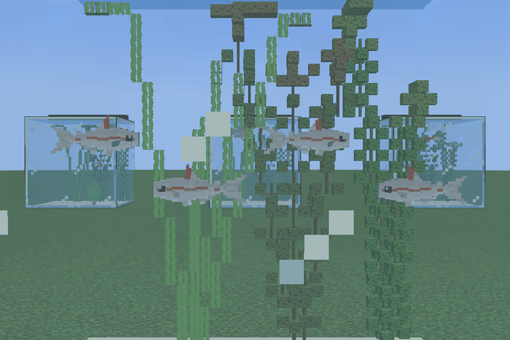

---
navigation:
  title: Glowlight Tetra
  icon: bettacraft:glowlight_tetra_bucket
  parent: tankmates/tetras.md
  position: 50
item_ids:
  - bettacraft:glowlight_tetra_bucket
  - bettacraft:glowlight_tetra_spawn_egg
---

# Glowlight Tetra

Translucent with a glowing orange-red line from snout to tail.

**Origin:** the Essequibo river in Guyana.

## Profile

| | |
|---|---|
| Group | Tetras |
| Scientific name | *Hemigrammus erythrozonus* |
| Size in the game | about 3.5 cm (0.29 blocks) |
| Temperature | 23–28 °C |
| Breeding temperature | 25–28 °C |
| Water | fresh water, normal |
| Shoal | from 6 fish |
| Swims | in the middle |
| Stocking | counts as 0.35 fish |
| Breeding | Scatters its eggs (fine plants, spawning mop), 20–50 young |
| Betta tank | yes |

## Breeding

At 25–28 °C a pair scatters 20–50 eggs into fine-leaved plants, java moss or a **spawning mop**. The parents and every other fish eat the eggs they reach; in a spawning mop most are safe. Live food (mosquito larvae) gets them ready faster.

## Obtaining

* **[Aquarium net](../equipment/tank_net.md)** in jungle water: 0.98–1.2 % per swing, 1–4 at a time.
* **Wild** in jungle water, in groups of 3–6 (spawn weight 8) (config `features.wildFish`).
* **Wandering trader** (rare offers): 6 for 7 emeralds; one of 5 in this offer.
* **[Breeding](breeding.md)**: Scatters its eggs (fine plants, spawning mop).
