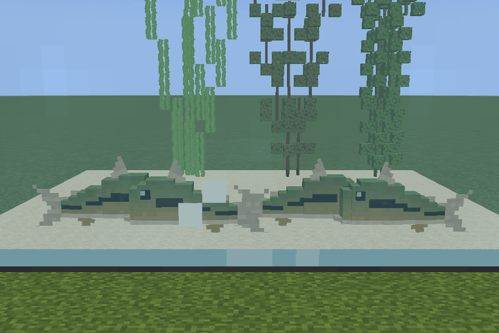

---
navigation:
  title: Green Gold Cory
  icon: bettacraft:green_gold_cory_bucket
  parent: tankmates/corydoras.md
  position: 40
item_ids:
  - bettacraft:green_gold_cory_bucket
  - bettacraft:green_gold_cory_spawn_egg
---

# Green Gold Cory

Gold-green with a dark side stripe and yellow-orange fins.

**Origin:** the Rio Meta region in Colombia.

## Profile

| | |
|---|---|
| Group | Corydoras |
| Scientific name | *Corydoras melanotaenia* |
| Size in the game | about 5.5 cm (0.46 blocks) |
| Temperature | 22–27 °C |
| Breeding temperature | 23–26 °C |
| Water | fresh water, normal |
| Water chemistry | pH 5.8–8.0, TDS 0–500 ppm |
| Shoal | from 6 fish |
| Swims | on the bottom |
| Stocking | counts as 0.55 fish |
| Breeding | Glues its eggs to the glass (after a cool water change), 12–30 young |
| Betta tank | too cool |
| Special | gulps air at the surface |

## Breeding

A cool water change sets them off: at least a quarter of the water fresh, cooling the tank by 1.5 °C. The female glues 12–30 eggs to the glass, the decoration and leaves. The other fish like to eat them: take them out with the net into a fish bag and raise them in a tank without adults.

## Keeping

* Bottom fish: gets only part of the sinking food while faster fish are around - algae wafers go straight to it.
* Darts up to the surface for a gulp of air now and then.

## Obtaining

* **[Aquarium net](../equipment/tank_net.md)** in rivers: 0.49–0.58 % per swing (about 1 in 173–205 swings), 1–4 at a time.
* **[Aquarium net](../equipment/tank_net.md)** in jungle water: 0.35–0.41 % per swing (about 1 in 242–287 swings), 1–4 at a time.
* **Wild** in rivers, in groups of 3–6 (spawn weight 3) (config `features.tankmates.wildSpawns`).
* **Wild** in jungle water, in groups of 3–6 (spawn weight 4) (config `features.tankmates.wildSpawns`).
* **Wandering trader** (rare offers): 6 for 8 emeralds; one of 13 in this offer.
* **[Breeding](breeding.md)**: Glues its eggs to the glass (after a cool water change).

The biomes of biome mods count too ([biome tags](../settings.md)).
