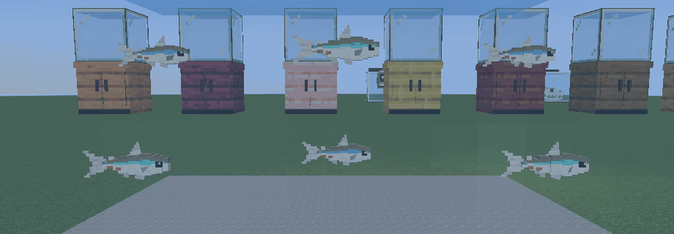

---
navigation:
  title: Green Neon Tetra
  icon: bettacraft:green_neon_tetra_bucket
  parent: tankmates.md
  position: 11
item_ids:
  - bettacraft:green_neon_tetra_bucket
  - bettacraft:green_neon_tetra_spawn_egg
---

# Green Neon Tetra

A species of its own, also sold as **Blue Neon**: smaller than the neon tetra, the stripe runs over almost the whole body
and there is hardly any red. In the wild form the stripe is green, in the **Blue Neon** blue (recessive: two blue
parents give blue young, a green fish can carry blue hidden).

| | |
|---|---|
| Family | Tetras |
| Scientific | *Paracheirodon simulans* |
| Size in the game | about 2.5 cm (0.22 blocks) |
| Origin | blackwater of the upper Rio Negro and Orinoco (Brazil, Colombia, Venezuela) |
| Temperature | 24–30 °C |
| Shoal | 6 or more |
| Water | very sensitive |
| Stocking | 0.25 fish |
| Colour forms | Green Neon (wild type), Blue Neon |
| Breeding | Scatters its eggs (fine plants, spawning mop), 26–29 °C |

## Neon tetra, cardinal, green neon

* [Neon tetra](neon_tetra.md): red only on the **rear** half of the body, likes it cooler (20–27 °C).
* [Cardinal tetra](cardinal_tetra.md): the red runs along the **whole** belly, likes it warm (24–30 °C).
* **Green neon**: hardly any red, the stripe green or blue along the whole body, the smallest of the three, warm.

## Breeding

At 26–29 °C a pair scatters 15–40 eggs into fine-leaved plants, java moss or a **spawning mop**. The parents and every
other fish eat the eggs they reach; in a spawning mop most are safe.

## Getting it

With the [aquarium net](../invertebrates/catching.md) in jungle water and from the wandering trader (now and then the
Blue Neon); then by breeding. The config switch `features.greenNeonTetra` turns new ones off.
