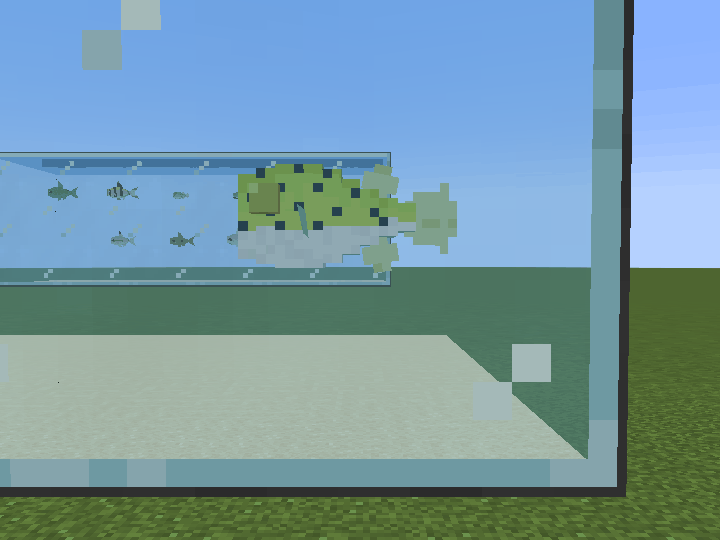

---
navigation:
  title: Green Spotted Puffer
  icon: bettacraft:green_spotted_puffer_bucket
  parent: tankmates/puffers.md
  position: 30
item_ids:
  - bettacraft:green_spotted_puffer_bucket
  - bettacraft:green_spotted_puffer_spawn_egg
---

# Green Spotted Puffer

A big, bright green puffer with round black spots and a white belly. It lives in **brackish water** and never in fresh water.

**Origin:** the mangroves and estuaries of South-East Asia.

## Profile

| | |
|---|---|
| Group | Puffers |
| Scientific name | *Tetraodon nigroviridis* |
| Size in the game | about 9.5 cm (0.8 blocks) |
| Temperature | 24–29 °C |
| Water | brackish water, also sea water, normal |
| Water chemistry | pH 7.2–8.6 |
| Shoal | alone or as a pair |
| Swims | in the middle |
| Stocking | counts as 2.5 fish |
| Breeding | Does not breed in a tank |
| Betta tank | too big |
| Special | eats snails, eats small fish and shrimp, needs snails or hard food for its teeth, nips long fins |

## Breeding

Practically never breeds in a tank.

## Keeping

* **Brackish water:** 5–30 ppt salt ([salt water](../saltwater.md): sea salt and a refractometer), hard and alkaline (pH 7.2–8.6). In fresh water it gets a salt shock and dies.
* **Eats snails:** about one snail a day (`tankmates.behaviour.pufferSnailsPerDay`), the bladder and ramshorn snails first; not the big apple snails, nerites seldom. A puffer is the cure for a snail plague, and a small snail tank feeds it.
* **Teeth:** a puffer's beak-like teeth never stop growing. Cracking snails or [shell food](../food/food_variety.md) wears them down; after 8 days without either (config `tankmates.behaviour.pufferTeethDays`) they have overgrown: the puffer is stressed and refuses all soft food until it gets a snail or shell food again.
* Eats shrimp and small fish too; nips fins. Big (counts 2.5 fish): keep it alone.

## Obtaining

* **[Aquarium net](../equipment/tank_net.md)** in mangrove swamps: 12–14 % per swing (about 1 in 7–8 swings).
* **Wild** in mangrove swamps, in groups of 1–1 (spawn weight 3) (config `features.puffers`).
* **Wandering trader** (rare offers): 2 for 9 emeralds; one of 11 in this offer.

The biomes of biome mods count too ([biome tags](../settings.md)).
