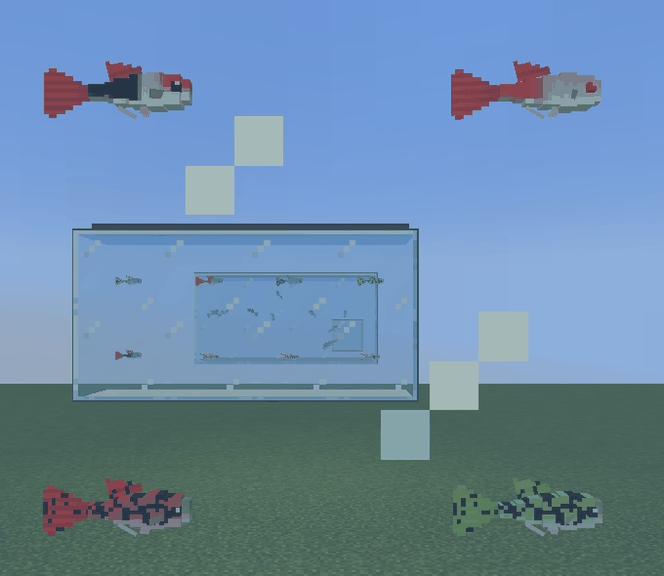

---
navigation:
  title: Guppy
  icon: bettacraft:guppy_bucket
  parent: tankmates.md
  position: 26
item_ids:
  - bettacraft:guppy_bucket
  - bettacraft:guppy_spawn_egg
---

# Guppy

Males with big colourful tails, females bigger and grey. Male bettas go for male guppies.

| | |
|---|---|
| Family | Livebearers |
| Scientific | *Poecilia reticulata* |
| Size in the game | about 4 cm (0.33 blocks) |
| Origin | Venezuela and Trinidad, today wild in warm waters worldwide |
| Temperature | 22–28 °C |
| Shoal | 3 or more |
| Water | hardy |
| Stocking | 0.35 fish |
| Breeding | Bears live young, 23–28 °C |

## Genetics and strains

Every guppy has its own genes for the tail shape, the body and tail colour, the tail pattern and the patterns on its
X and Y chromosome: the Y patterns (cobra, japan blue, red tail, ...) go only from the father to his sons. Females are
grey with small tails but carry the genes. Fish whose look matches a known strain get its name: Red Cobra, Blue
Moscow, Full Gold, Tuxedo Koi, Japan Blue, Blue Grass and many more. Guppies cross with endlers (hybrids). Everything
about it: [Guppy Genetics](guppy_genetics.md).

With `features.livebearerGenetics` off the old fixed varieties show: Wild type, Red, Blue Grass, Green Cobra, Tuxedo.

## Breeding

At 23–28 °C a female with a male gets pregnant and gives birth to 5–16 young after 3 days. The adults eat fry: plants hide them, a **breeding box** in the tank catches them.

## Keeping

* Male bettas go for the males of this species (config `tankmates.behaviour.bettaAggression`).

## Getting it

With the [aquarium net](../invertebrates/catching.md) in rivers and from the wandering trader; then by breeding.
