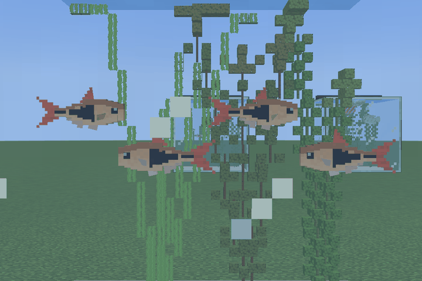

---
navigation:
  title: Harlequin Rasbora
  icon: bettacraft:harlequin_rasbora_bucket
  parent: tankmates.md
  position: 14
item_ids:
  - bettacraft:harlequin_rasbora_bucket
  - bettacraft:harlequin_rasbora_spawn_egg
---

# Harlequin Rasbora

Copper body with a black wedge; spawns upside down under broad leaves.

| | |
|---|---|
| Family | Rasboras |
| Scientific | *Trigonostigma heteromorpha* |
| Size in the game | about 4 cm (0.37 blocks) |
| Origin | the peat swamps of Malaysia, Sumatra and Borneo |
| Temperature | 22–28 °C |
| Shoal | 6 or more |
| Water | sensitive |
| Stocking | 0.45 fish |
| Breeding | Scatters its eggs (fine plants, spawning mop), 26–28 °C |

## Breeding

At 26–28 °C a pair scatters 15–40 eggs into broad leaves (crypts, anubias, sword plants) or a spawning mop. The parents and every other fish eat the eggs they reach; in a spawning mop most are safe. Live food (mosquito larvae) gets them ready faster.

## Getting it

With the [aquarium net](../invertebrates/catching.md) in swamps and from the wandering trader; then by breeding.
