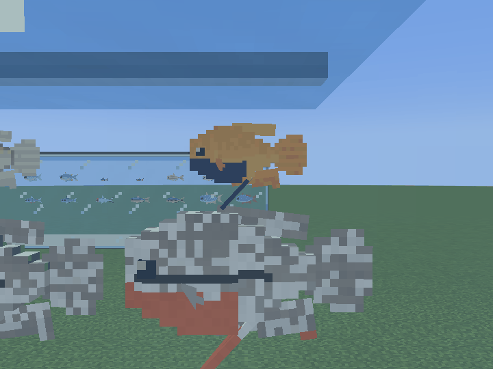

---
navigation:
  title: Honey Gourami
  icon: bettacraft:honey_gourami_bucket
  parent: tankmates/gouramis.md
  position: 20
item_ids:
  - bettacraft:honey_gourami_bucket
  - bettacraft:honey_gourami_spawn_egg
---

# Honey Gourami

The smallest and calmest gourami: the male honey-orange with a dark blue-black throat and a yellow dorsal fin, the female beige with a brown stripe.

**Origin:** ponds and slow rivers of north-eastern India and Bangladesh.

## Profile

| | |
|---|---|
| Group | Gouramis |
| Scientific name | *Trichogaster chuna* |
| Size in the game | about 5 cm (0.4 blocks) |
| Temperature | 22–28 °C |
| Breeding temperature | 25–28 °C |
| Water | fresh water, normal |
| Water chemistry | pH 6.0–8.0, TDS 0–500 ppm |
| Shoal | alone or as a pair |
| Swims | near the surface |
| Stocking | counts as 0.6 fish |
| Breeding | Builds a foam nest, 20–60 young |
| Betta tank | yes |
| Special | breathes air (labyrinth fish), 3 colour varieties |

## Varieties

Varieties: Wild type, Gold, Red. The wild type is dominant, the bred varieties are recessive: only two equal alleles show the colour (carriers look wild). Of two different bred varieties the one listed first shows. Wild fish now and then carry a bred variety hidden; the menu shows the genes in a tooltip.

## Breeding

Like a betta: at 25–28 °C the male builds a foam nest at the surface (floating plants help), the female spawns 20–60 eggs into it, then the male chases her away and guards the nest.

## Keeping

* **Labyrinth fish:** breathes air at the surface like a betta, so it copes with still water and little oxygen.
* Peaceful: the males do not fight, and male bettas usually leave it alone.

## Obtaining

* **[Aquarium net](../equipment/tank_net.md)** in rivers: 0.27–0.32 % per swing (about 1 in 317–375 swings).
* **[Aquarium net](../equipment/tank_net.md)** in swamps: 0.6–0.71 % per swing (about 1 in 141–167 swings).
* **Wild** in rivers, alone (spawn weight 2) (config `features.tankmates.gouramis`).
* **Wild** in swamps, alone (spawn weight 3) (config `features.tankmates.gouramis`).
* **Wandering trader** (usual offers): 2 for 3 emeralds; one of 36 in this offer.
* **[Aquarist villager](../getting_started/aquarist.md)** (Master): 2 for 14 emeralds; one of about 14 in this offer (config `features.tankmates.gouramis`).
* **[Breeding](breeding.md)**: Builds a foam nest.

The biomes of biome mods count too ([biome tags](../settings.md)).
