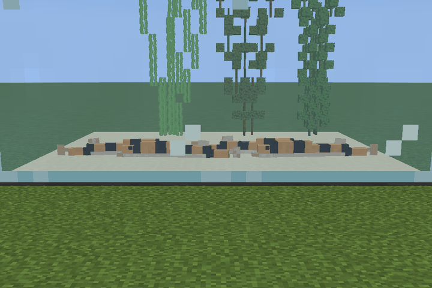

---
navigation:
  title: Kuhli Loach
  icon: bettacraft:kuhli_loach_bucket
  parent: tankmates/loaches.md
  position: 10
item_ids:
  - bettacraft:kuhli_loach_bucket
  - bettacraft:kuhli_loach_spawn_egg
---

# Kuhli Loach

An eel-like banded loach that rests in hiding by day and roams the bottom at night.

**Origin:** the peat swamps of Indonesia and Malaysia.

## Profile

| | |
|---|---|
| Group | Loaches |
| Scientific name | *Pangio kuhlii* |
| Size in the game | about 7 cm (0.6 blocks) |
| Temperature | 24–30 °C |
| Breeding temperature | 25–28 °C |
| Water | fresh water, normal |
| Water chemistry | pH 5.0–7.8, TDS 0–450 ppm |
| Shoal | from 5 fish |
| Swims | on the bottom |
| Stocking | counts as 0.4 fish |
| Breeding | Scatters its eggs (fine plants, spawning mop), 15–50 young |
| Betta tank | yes |
| Special | active at night |

## Breeding

At 25–28 °C a pair scatters 15–50 eggs into fine-leaved plants, java moss or a **spawning mop**. The parents and every other fish eat the eggs they reach; in a spawning mop most are safe. Live food (mosquito larvae) gets them ready faster.

## Keeping

* Bottom fish: gets only part of the sinking food while faster fish are around - algae wafers go straight to it.
* Mostly resting by day, active at night.

## Obtaining

* **[Aquarium net](../equipment/tank_net.md)** in swamps: 1.9–2.2 % per swing (about 1 in 45–53 swings), 1–4 at a time.
* **Wild** in swamps, in groups of 3–5 (spawn weight 6) (config `features.wildFish`).
* **Wandering trader** (usual offers): 6 for 4 emeralds; one of 16 in this offer.
* **[Breeding](breeding.md)**: Scatters its eggs (fine plants, spawning mop).

The biomes of biome mods count too ([biome tags](../settings.md)).
