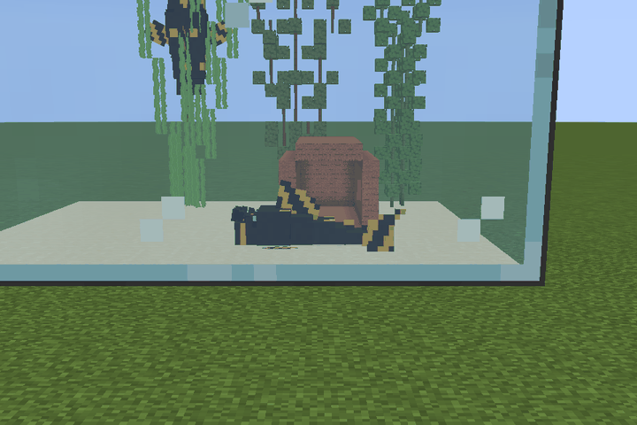

---
navigation:
  title: L134 Leopard Frog Pleco
  icon: bettacraft:leopard_frog_pleco_bucket
  parent: tankmates/plecos.md
  position: 20
item_ids:
  - bettacraft:leopard_frog_pleco_bucket
  - bettacraft:leopard_frog_pleco_spawn_egg
---

# L134 Leopard Frog Pleco

A small pleco with yellow and black bands. Lives in caves and on the glass, eats algae a little and needs warm water.

**Origin:** the Rio Tapajós in Brazil.

## Profile

| | |
|---|---|
| Group | Plecos |
| Scientific name | *Peckoltia compta (L134)* |
| Size in the game | about 7 cm (0.6 blocks) |
| Temperature | 25–30 °C |
| Breeding temperature | 27–30 °C |
| Water | fresh water, normal |
| Water chemistry | pH 5.8–8.0, TDS 0–550 ppm |
| Shoal | alone or as a pair |
| Swims | on the glass and the bottom |
| Stocking | counts as 1 fish |
| Breeding | Spawns in a cave, the male guards, 8–20 young |
| Betta tank | yes |
| Special | territorial |

## Breeding

Needs a **spawning cave** (decoration) and 27–30 °C. Every male claims a cave; a pair spawns 8–20 eggs in it and the male guards eggs and larvae until the young swim out. Without the male the clutch dies.

## Keeping

* Eats some algae.
* Bottom fish: gets only part of the sinking food while faster fish are around - algae wafers go straight to it.
* Males defend their cave: give several males several caves.

## Obtaining

* **[Aquarium net](../equipment/tank_net.md)** in jungle water: 0.27–0.32 % per swing (about 1 in 316–374 swings).
* **Wild** in jungle water, in groups of 1–1 (spawn weight 3) (config `features.wildFish`).
* **Wandering trader** (rare offers): 2 for 7 emeralds; one of 11 in this offer.
* **[Breeding](breeding.md)**: Spawns in a cave, the male guards.

The biomes of biome mods count too ([biome tags](../settings.md)).
