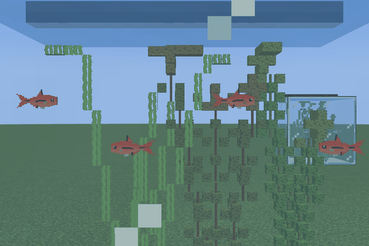

---
navigation:
  title: Mosquito Rasbora
  icon: bettacraft:mosquito_rasbora_bucket
  parent: tankmates/rasboras.md
  position: 20
item_ids:
  - bettacraft:mosquito_rasbora_bucket
  - bettacraft:mosquito_rasbora_spawn_egg
---

# Mosquito Rasbora

One of the smallest aquarium fish (about 2 cm), red with a dark line. Also sold as chili rasbora - it is the same species.

**Origin:** the blackwater peat swamps of Borneo.

## Profile

| | |
|---|---|
| Group | Rasboras |
| Scientific name | *Boraras brigittae* |
| Size in the game | about 2 cm (0.15 blocks) |
| Temperature | 22–28 °C |
| Breeding temperature | 25–28 °C |
| Water | fresh water, sensitive |
| Shoal | from 8 fish |
| Swims | near the surface |
| Stocking | counts as 0.12 fish |
| Breeding | Scatters its eggs (fine plants, spawning mop), 8–25 young |
| Betta tank | yes |

## Breeding

At 25–28 °C a pair scatters 8–25 eggs into fine-leaved plants, java moss or a **spawning mop**. The parents and every other fish eat the eggs they reach; in a spawning mop most are safe. Live food (mosquito larvae) gets them ready faster.

## Obtaining

* **[Aquarium net](../equipment/tank_net.md)** in swamps: 3.7–4.4 % per swing, 1–4 at a time.
* **Wild** in swamps, in groups of 3–6 (spawn weight 11) (config `features.wildFish`).
* **Wandering trader** (usual offers): 8 for 3 emeralds; one of 16 in this offer.
* **[Breeding](breeding.md)**: Scatters its eggs (fine plants, spawning mop).
