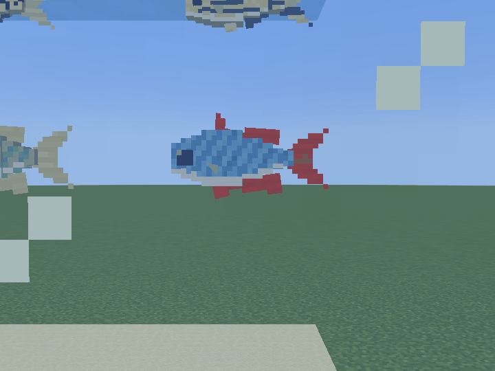

---
navigation:
  title: Neon Dwarf Rainbowfish
  icon: bettacraft:neon_dwarf_rainbow_bucket
  parent: tankmates/rainbowfish.md
  position: 20
item_ids:
  - bettacraft:neon_dwarf_rainbow_bucket
  - bettacraft:neon_dwarf_rainbow_spawn_egg
---

# Neon Dwarf Rainbowfish

A deep-bodied rainbowfish with two dorsal fins and shining neon-blue scales; the male has red fins, the female yellowish ones.

**Origin:** the rivers of the Mamberamo basin in western New Guinea.

## Profile

| | |
|---|---|
| Group | Rainbowfish |
| Scientific name | *Melanotaenia praecox* |
| Size in the game | about 6 cm (0.5 blocks) |
| Temperature | 23–28 °C |
| Breeding temperature | 25–27 °C |
| Water | fresh water, normal |
| Water chemistry | pH 6.5–8.5, TDS 50–700 ppm |
| Shoal | from 6 fish |
| Swims | in the middle |
| Stocking | counts as 0.6 fish |
| Breeding | Scatters its eggs (fine plants, spawning mop), 15–40 young |
| Betta tank | yes |

## Breeding

At 25–27 °C a pair scatters 15–40 eggs into fine-leaved plants, java moss or a **spawning mop**. The parents and every other fish eat the eggs they reach; in a spawning mop most are safe. Live food gets them ready faster.

## Keeping

* Active swimmers: give them room and a shoal of 6 or more.
* Peaceful; the males show off to each other in the morning light.

## Obtaining

* **[Aquarium net](../equipment/tank_net.md)** in rivers: 0.36–0.42 % per swing (about 1 in 238–281 swings), 1–4 at a time.
* **[Aquarium net](../equipment/tank_net.md)** in jungle water: 0.27–0.32 % per swing (about 1 in 316–374 swings), 1–4 at a time.
* **Wild** in rivers, in groups of 3–6 (spawn weight 2) (config `features.communityFish`).
* **Wild** in jungle water, in groups of 3–6 (spawn weight 3) (config `features.communityFish`).
* **Wandering trader** (usual offers): 6 for 5 emeralds; one of 36 in this offer.
* **[Breeding](breeding.md)**: Scatters its eggs (fine plants, spawning mop).

The biomes of biome mods count too ([biome tags](../settings.md)).
