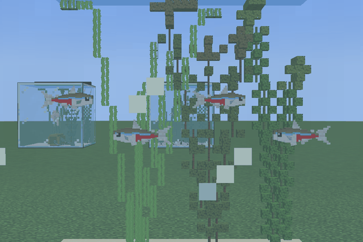

---
navigation:
  title: Neon Tetra
  icon: bettacraft:neon_tetra_bucket
  parent: tankmates/tetras.md
  position: 10
item_ids:
  - bettacraft:neon_tetra_bucket
  - bettacraft:neon_tetra_spawn_egg
---

# Neon Tetra

A blue neon stripe over a red rear half: the classic shoal fish.

**Origin:** the blackwater streams of the upper Amazon (Peru, Colombia).

## Profile

| | |
|---|---|
| Group | Tetras |
| Scientific name | *Paracheirodon innesi* |
| Size in the game | about 3 cm (0.25 blocks) |
| Temperature | 20–27 °C |
| Breeding temperature | 22–25 °C |
| Water | fresh water, sensitive |
| Water chemistry | pH 5.0–7.8, TDS 0–450 ppm |
| Shoal | from 6 fish |
| Swims | in the middle |
| Stocking | counts as 0.35 fish |
| Breeding | Scatters its eggs (fine plants, spawning mop), 20–50 young |
| Betta tank | too cool |

## Breeding

At 22–25 °C a pair scatters 20–50 eggs into fine-leaved plants, java moss or a **spawning mop**. The parents and every other fish eat the eggs they reach; in a spawning mop most are safe. Live food (mosquito larvae) gets them ready faster.

## Obtaining

* **[Aquarium net](../equipment/tank_net.md)** in jungle water: 1.3–1.6 % per swing (about 1 in 63–75 swings), 1–4 at a time.
* **Wild** in jungle water, in groups of 3–6 (spawn weight 15) (config `features.tankmates.wildSpawns`).
* **Wandering trader** (usual offers): 6 for 4 emeralds; one of 36 in this offer.
* **[Breeding](breeding.md)**: Scatters its eggs (fine plants, spawning mop).

The biomes of biome mods count too ([biome tags](../settings.md)).
