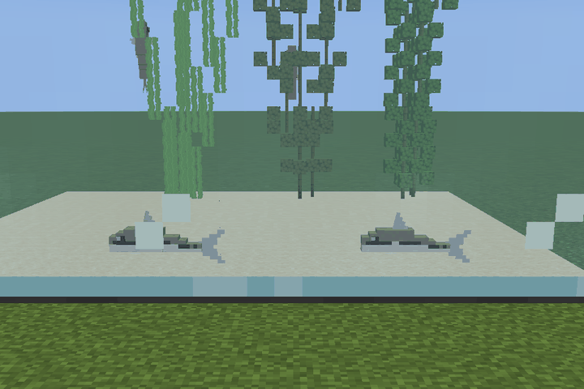

---
navigation:
  title: Otocinclus
  icon: bettacraft:otocinclus_bucket
  parent: tankmates.md
  position: 23
item_ids:
  - bettacraft:otocinclus_bucket
  - bettacraft:otocinclus_spawn_egg
---

# Otocinclus

A tiny sucker catfish that grazes the glass and the leaves clean, in a small group.

| | |
|---|---|
| Family | Otocinclus |
| Scientific | *Otocinclus vittatus* |
| Size in the game | about 4 cm (0.33 blocks) |
| Origin | plant-rich streams of South America |
| Temperature | 21–27 °C |
| Shoal | 5 or more |
| Water | very sensitive |
| Stocking | 0.3 fish |
| Breeding | Glues its eggs to the glass (after a cool water change), 22–26 °C |

## Breeding

Rarely, at 22–26 °C: a few eggs on the glass and leaves (6–18).

## Keeping

* Grazes the algae off the glass and partly lives on them; without algae it needs algae wafers.
* Bottom fish: gets only part of the sinking food while faster fish are around - algae wafers go straight to it.

## Getting it

With the [aquarium net](../invertebrates/catching.md) in jungle water, rivers and from the wandering trader; then by breeding.
