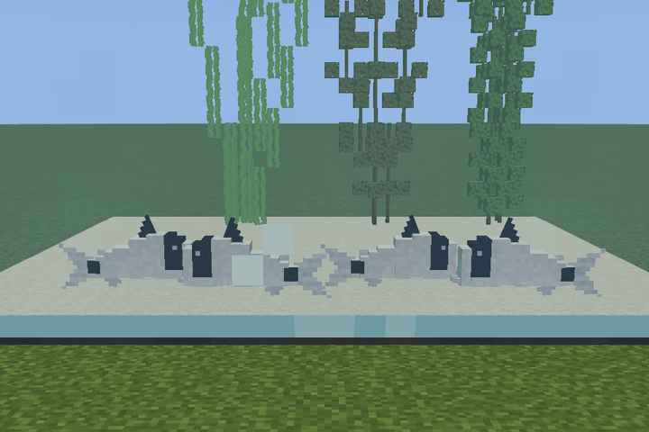

---
navigation:
  title: Panda Cory
  icon: bettacraft:panda_cory_bucket
  parent: tankmates.md
  position: 17
item_ids:
  - bettacraft:panda_cory_bucket
  - bettacraft:panda_cory_spawn_egg
---

# Panda Cory

Cream with a black eye mask, black dorsal fin and a spot at the tail base. Likes it cool.

| | |
|---|---|
| Family | Corydoras |
| Scientific | *Corydoras panda* |
| Size in the game | about 4 cm (0.37 blocks) |
| Origin | cool clear streams of the Rio Ucayali in Peru |
| Temperature | 20–26 °C |
| Shoal | 6 or more |
| Water | sensitive |
| Stocking | 0.45 fish |
| Breeding | Glues its eggs to the glass (after a cool water change), 21–25 °C |

## Breeding

A cool water change sets them off: at least a quarter of the water fresh, cooling the tank by 1.5 °C. The female glues 12–30 eggs to the glass, the decoration and leaves. The other fish like to eat them: take them out with the net into a fish bag and raise them in a tank without adults.

## Keeping

* Bottom fish: gets only part of the sinking food while faster fish are around - algae wafers go straight to it.
* Darts up to the surface for a gulp of air now and then.

## Getting it

With the [aquarium net](../invertebrates/catching.md) in jungle water and from the wandering trader; then by breeding.
