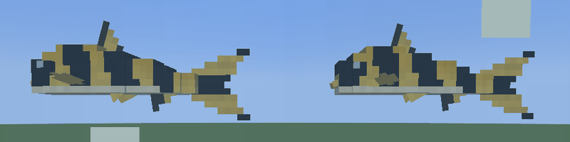

---
navigation:
  title: Panda Garra
  icon: bettacraft:panda_garra_bucket
  parent: tankmates/loaches.md
  position: 60
item_ids:
  - bettacraft:panda_garra_bucket
  - bettacraft:panda_garra_spawn_egg
---

# Panda Garra

A small, slim garra in golden yellow with broad black bands and a sucker mouth; busy all day grazing stones and glass.

**Origin:** clear, fast hill streams of the Rakhine Yoma in western Myanmar.

## Profile

| | |
|---|---|
| Group | Loaches |
| Scientific name | *Garra flavatra* |
| Size in the game | about 6.5 cm (0.55 blocks) |
| Temperature | 20–26 °C |
| Breeding temperature | 22–25 °C |
| Water | fresh water, sensitive |
| Water chemistry | pH 6.5–8.0, TDS 50–500 ppm |
| Shoal | from 5 fish |
| Swims | on the bottom |
| Stocking | counts as 0.6 fish |
| Breeding | Scatters its eggs (fine plants, spawning mop), 10–40 young |
| Betta tank | too cool |
| Special | eats algae |

## Breeding

At 22–25 °C a pair scatters 10–40 eggs over gravel, fine-leaved plants, java moss or a **spawning mop**. The parents and every
other fish eat the eggs they reach; in a spawning mop most are safe. Live food gets them ready faster.

## Keeping

* Grazes algae from the glass, stones and decoration like an otocinclus.
* Wants cooler (20–26 °C), clean, well-aerated water with some current; keep a group of 5 or more.
* Small and peaceful (unlike the bigger *Garra rufa*), fine with a betta in a cooler tank.

## Obtaining

* **[Aquarium net](../equipment/tank_net.md)** in rivers: 0.32–0.38 % per swing (about 1 in 260–308 swings), 1–4 at a time.
* **Wild** in rivers, in groups of 3–5 (spawn weight 2) (config `features.tankmates.moreBottomFish`).
* **Wandering trader** (rare offers): 6 for 8 emeralds; one of 13 in this offer.
* **[Breeding](breeding.md)**: Scatters its eggs (fine plants, spawning mop).

The biomes of biome mods count too ([biome tags](../settings.md)).
