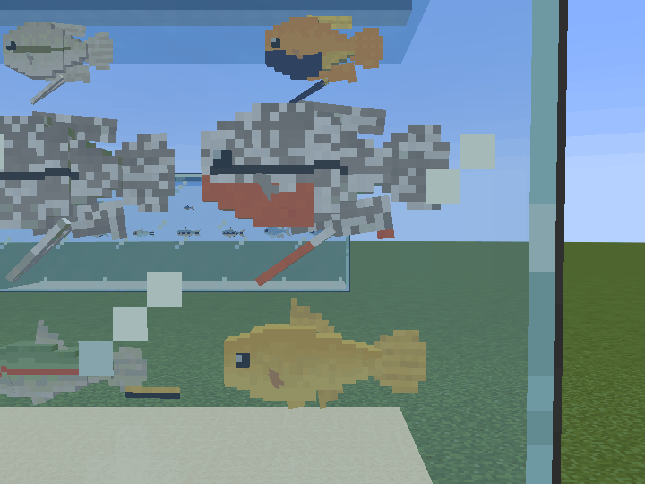

---
navigation:
  title: Pearl Gourami
  icon: bettacraft:pearl_gourami_bucket
  parent: tankmates/gouramis.md
  position: 40
item_ids:
  - bettacraft:pearl_gourami_bucket
  - bettacraft:pearl_gourami_spawn_egg
---

# Pearl Gourami

A big, elegant gourami covered with pearly dots and a dark line from the snout to the tail; the male has an orange-red throat and long fins.

**Origin:** the swamps of Thailand, Malaysia, Sumatra and Borneo.

## Profile

| | |
|---|---|
| Group | Gouramis |
| Scientific name | *Trichopodus leerii* |
| Size in the game | about 10 cm (0.85 blocks) |
| Temperature | 24–30 °C |
| Breeding temperature | 27–29 °C |
| Water | fresh water, normal |
| Water chemistry | pH 6.0–8.0, TDS 0–500 ppm |
| Shoal | alone or as a pair |
| Swims | near the surface |
| Stocking | counts as 1.6 fish |
| Breeding | Builds a foam nest, 30–80 young |
| Betta tank | no |
| Special | breathes air (labyrinth fish), territorial, chased by male bettas |

## Breeding

Like a betta: at 27–29 °C the male builds a foam nest at the surface (floating plants help), the female spawns 30–80 eggs into it, then the male chases her away and guards the nest.

## Keeping

* **Labyrinth fish:** breathes air at the surface like a betta, so it copes with still water and little oxygen.
* Keep a pair: two males fight for territories, and male bettas go for the males (`tankmates.behaviour.bettaAggression`).

## Obtaining

* **[Aquarium net](../equipment/tank_net.md)** in swamps: 0.5–0.59 % per swing (about 1 in 169–200 swings).
* **[Aquarium net](../equipment/tank_net.md)** in jungle water: 0.13–0.16 % per swing (about 1 in 631–748 swings).
* **Wild** in swamps, alone (spawn weight 3) (config `features.tankmates.gouramis`).
* **Wild** in jungle water, alone (spawn weight 2) (config `features.tankmates.gouramis`).
* **Wandering trader** (usual offers): 2 for 5 emeralds; one of 36 in this offer.
* **[Breeding](breeding.md)**: Builds a foam nest.

The biomes of biome mods count too ([biome tags](../settings.md)).
