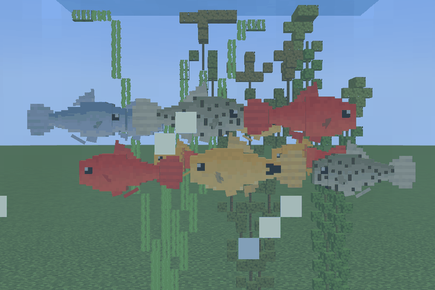

---
navigation:
  title: Platy
  icon: bettacraft:platy_bucket
  parent: tankmates/livebearers.md
  position: 30
item_ids:
  - bettacraft:platy_bucket
  - bettacraft:platy_spawn_egg
---

# Platy

A sturdy, peaceful livebearer in many colours.

**Origin:** Mexico and Central America.

## Profile

| | |
|---|---|
| Group | Livebearers |
| Scientific name | *Xiphophorus maculatus* |
| Size in the game | about 5 cm (0.42 blocks) |
| Temperature | 20–27 °C |
| Breeding temperature | 22–26 °C |
| Water | fresh or brackish water, hardy |
| Water chemistry | pH 6.8–8.6, TDS 100–800 ppm |
| Shoal | from 3 fish |
| Swims | in the middle |
| Stocking | counts as 0.5 fish |
| Breeding | Bears live young, 8–25 young |
| Betta tank | too cool |
| Special | 5 colour varieties |

## Varieties

Varieties: Wild type, Red, Sunset, Mickey Mouse, Blue. The wild type is dominant, the bred varieties are recessive: only two equal alleles show the colour (carriers look wild). Of two different bred varieties the one listed first shows. Wild fish now and then carry a bred variety hidden; the menu shows the genes in a tooltip.

## Breeding

At 22–26 °C a female with a male gets pregnant and gives birth to 8–25 young after 3 days. The adults eat fry: plants hide them, a **breeding box** in the tank catches them.

## Obtaining

* **[Aquarium net](../equipment/tank_net.md)** in rivers: 2.1–2.5 % per swing (about 1 in 40–48 swings), 1–4 at a time.
* **Wild** in rivers, in groups of 3–3 (spawn weight 5) (config `features.wildFish`).
* **Wandering trader** (usual offers): 6 for 4 emeralds; one of 20 in this offer.
* **[Breeding](breeding.md)**: Bears live young.

The biomes of biome mods count too ([biome tags](../settings.md)).
