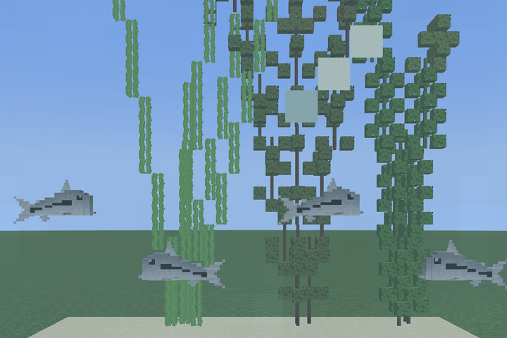

---
navigation:
  title: Pygmy Cory
  icon: bettacraft:pygmy_cory_bucket
  parent: tankmates.md
  position: 16
item_ids:
  - bettacraft:pygmy_cory_bucket
  - bettacraft:pygmy_cory_spawn_egg
---

# Pygmy Cory

A tiny cory that often hovers in a loose shoal in the middle of the water.

| | |
|---|---|
| Family | Corydoras |
| Scientific | *Corydoras pygmaeus* |
| Size in the game | about 3 cm (0.21 blocks) |
| Origin | the Rio Madeira (Brazil) |
| Temperature | 22–27 °C |
| Shoal | 8 or more |
| Water | sensitive |
| Stocking | 0.2 fish |
| Breeding | Glues its eggs to the glass (after a cool water change), 22–26 °C |

## Breeding

A cool water change sets them off: at least a quarter of the water fresh, cooling the tank by 1.5 °C. The female glues 10–25 eggs to the glass, the decoration and leaves. The other fish like to eat them: take them out with the net into a fish bag and raise them in a tank without adults.

## Keeping

* Darts up to the surface for a gulp of air now and then.

## Getting it

With the [aquarium net](../invertebrates/catching.md) in jungle water and from the wandering trader; then by breeding.
