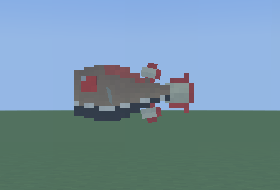

---
navigation:
  title: Red-Eye Puffer
  icon: bettacraft:red_eye_puffer_bucket
  parent: tankmates/puffers.md
  position: 20
item_ids:
  - bettacraft:red_eye_puffer_bucket
  - bettacraft:red_eye_puffer_spawn_egg
---

# Red-Eye Puffer

A small brown puffer with red eyes; the male shows a dark belly edged white, a red keel on the back and red fin edges, the female is spotted.

**Origin:** the blackwater streams of Sumatra and Borneo.

## Profile

| | |
|---|---|
| Group | Puffers |
| Scientific name | *Carinotetraodon irrubesco* |
| Size in the game | about 3.5 cm (0.3 blocks) |
| Temperature | 23–29 °C |
| Breeding temperature | 25–28 °C |
| Water | fresh water, sensitive |
| Water chemistry | pH 5.0–7.6, TDS 0–400 ppm |
| Shoal | alone or as a pair |
| Swims | in the middle |
| Stocking | counts as 0.5 fish |
| Breeding | Scatters its eggs (fine plants, spawning mop), 5–12 young |
| Betta tank | no (nips fins) |
| Special | eats snails, needs snails or hard food for its teeth, nips long fins |

## Breeding

At 25–28 °C a pair scatters 5–12 eggs into fine-leaved plants, java moss or a **spawning mop**. The parents and every other fish eat the eggs they reach; in a spawning mop most are safe. Live food gets them ready faster.

## Keeping

* **Eats snails:** about one snail a day (`tankmates.behaviour.pufferSnailsPerDay`), the bladder and ramshorn snails first; not the big apple snails, nerites seldom. A puffer is the cure for a snail plague, and a small snail tank feeds it.
* **Teeth:** a puffer's beak-like teeth never stop growing. Cracking snails or [shell food](../food/food_variety.md) wears them down; after 8 days without either (config `tankmates.behaviour.pufferTeethDays`) they have overgrown: the puffer is stressed and refuses all soft food until it gets a snail or shell food again.
* **Fin nipper:** goes for the long fins of bettas, angelfish, gouramis and male guppies: they flee, are stressed and lose hit points (`tankmates.behaviour.finNipping`). Not with bettas.
* Soft, acidic water; males are quarrelsome - one male with several females.

## Obtaining

* **[Aquarium net](../equipment/tank_net.md)** in swamps: 0.3–0.35 % per swing (about 1 in 282–334 swings).
* **[Aquarium net](../equipment/tank_net.md)** in jungle water: 0.09–0.11 % per swing (about 1 in 947–1121 swings).
* **Wild** in swamps, in groups of 1–1 (spawn weight 2) (config `features.puffers`).
* **Wild** in jungle water, in groups of 1–1 (spawn weight 1) (config `features.puffers`).
* **Wandering trader** (rare offers): 2 for 6 emeralds; one of 12 in this offer.
* **[Breeding](breeding.md)**: Scatters its eggs (fine plants, spawning mop).

The biomes of biome mods count too ([biome tags](../settings.md)).
