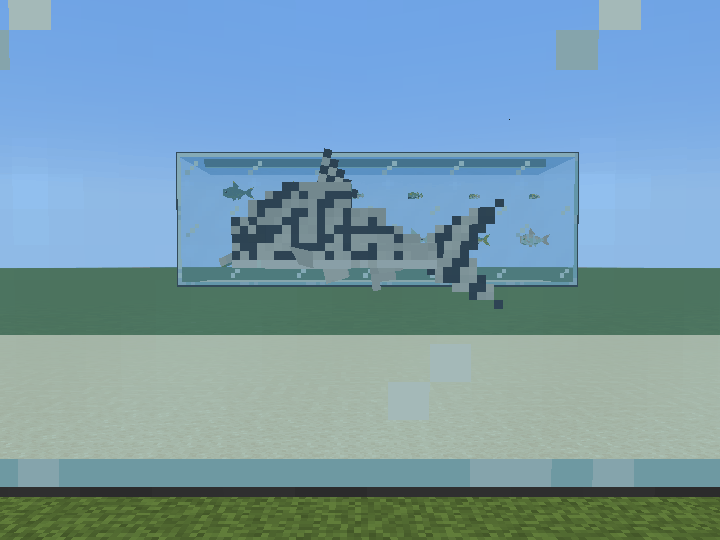

---
navigation:
  title: Reticulated Loach
  icon: bettacraft:reticulated_loach_bucket
  parent: tankmates/loaches.md
  position: 40
item_ids:
  - bettacraft:reticulated_loach_bucket
  - bettacraft:reticulated_loach_spawn_egg
---

# Reticulated Loach

Grey-cream with a dark net of Y-shaped bands (Botia lohachata); a busy loach of about 10 cm.

**Origin:** the rivers of northern India, Nepal and Bangladesh.

## Profile

| | |
|---|---|
| Group | Loaches |
| Scientific name | *Botia lohachata* |
| Size in the game | about 9 cm (0.75 blocks) |
| Temperature | 24–30 °C |
| Water | fresh water, normal |
| Water chemistry | pH 6.0–8.0, TDS 0–550 ppm |
| Shoal | from 5 fish |
| Swims | in the lower water |
| Stocking | counts as 1.5 fish |
| Breeding | Does not breed in a tank |
| Betta tank | yes |
| Special | eats snails |

## Breeding

Practically never breeds in a tank.

## Keeping

* Eats snails (not the big apple snails; `tankmates.behaviour.clownLoachSnailsPerDay`).
* Bottom fish: gets only part of the sinking food while faster fish are around - algae wafers go straight to it.
* In a group of 5 or more; counts 1.5 fish.

## Obtaining

* **[Aquarium net](../equipment/tank_net.md)** in rivers: 0.36–0.42 % per swing (about 1 in 238–281 swings), 1–4 at a time.
* **[Aquarium net](../equipment/tank_net.md)** in swamps: 0.2–0.24 % per swing (about 1 in 423–501 swings), 1–4 at a time.
* **Wild** in rivers, in groups of 3–5 (spawn weight 2) (config `features.barbsAndLoaches`).
* **Wild** in swamps, in groups of 3–5 (spawn weight 1) (config `features.barbsAndLoaches`).
* **Wandering trader** (rare offers): 6 for 12 emeralds; one of 12 in this offer.

The biomes of biome mods count too ([biome tags](../settings.md)).
