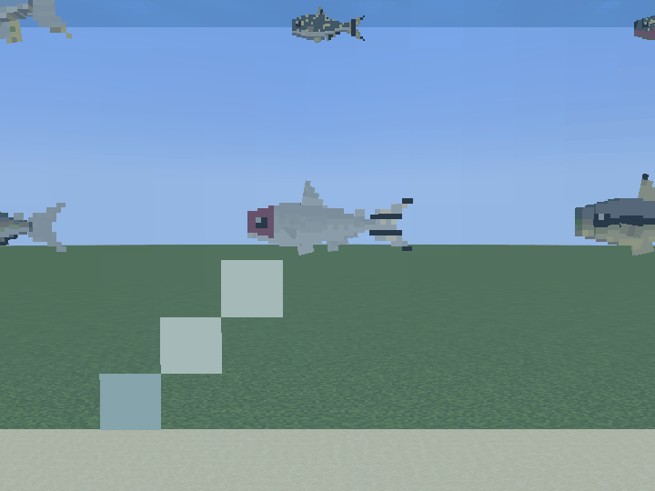

---
navigation:
  title: Rummy-Nose Tetra
  icon: bettacraft:rummy_nose_tetra_bucket
  parent: tankmates/tetras.md
  position: 70
item_ids:
  - bettacraft:rummy_nose_tetra_bucket
  - bettacraft:rummy_nose_tetra_spawn_egg
---

# Rummy-Nose Tetra

Silver with a bright red head and a tail striped black and white; swims in a tight shoal.

**Origin:** the blackwater of the lower Amazon and the Rio Negro.

## Profile

| | |
|---|---|
| Group | Tetras |
| Scientific name | *Hemigrammus rhodostomus* |
| Size in the game | about 5 cm (0.4 blocks) |
| Temperature | 24–29 °C |
| Breeding temperature | 26–28 °C |
| Water | fresh water, sensitive |
| Water chemistry | pH 5.0–7.8, TDS 0–450 ppm |
| Shoal | from 8 fish |
| Swims | in the middle |
| Stocking | counts as 0.4 fish |
| Breeding | Scatters its eggs (fine plants, spawning mop), 15–40 young |
| Betta tank | yes |

## Breeding

At 26–28 °C a pair scatters 15–40 eggs into fine-leaved plants, java moss or a **spawning mop**. The parents and every other fish eat the eggs they reach; in a spawning mop most are safe. Live food gets them ready faster.

## Keeping

* A water indicator: it is sensitive and its red fades in bad water.
* A shoal of 8 or more, soft water, 24–29 °C: fits a betta tank.

## Obtaining

* **[Aquarium net](../equipment/tank_net.md)** in jungle water: 0.54–0.63 % per swing (about 1 in 158–187 swings), 1–4 at a time.
* **Wild** in jungle water, in groups of 3–6 (spawn weight 6) (config `features.communityFish`).
* **Wandering trader** (usual offers): 8 for 5 emeralds; one of 36 in this offer.
* **[Breeding](breeding.md)**: Scatters its eggs (fine plants, spawning mop).

The biomes of biome mods count too ([biome tags](../settings.md)).
