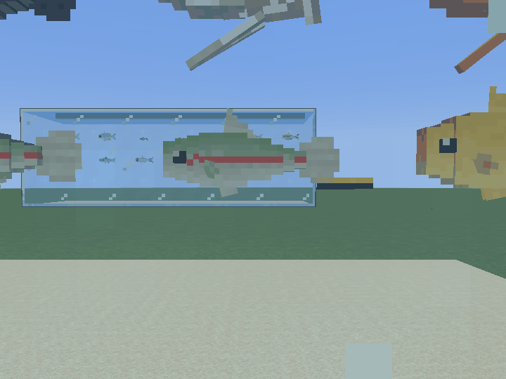

---
navigation:
  title: Swordtail
  icon: bettacraft:swordtail_bucket
  parent: tankmates/livebearers.md
  position: 60
item_ids:
  - bettacraft:swordtail_bucket
  - bettacraft:swordtail_spawn_egg
---

# Swordtail

Olive-green with a red zigzag line along the side; the male carries a long yellow "sword" edged black on the lower edge of the tail.

**Origin:** the rivers of eastern Mexico and Central America.

## Profile

| | |
|---|---|
| Group | Livebearers |
| Scientific name | *Xiphophorus hellerii* |
| Size in the game | about 7 cm (0.6 blocks) |
| Temperature | 22–28 °C |
| Breeding temperature | 23–27 °C |
| Water | fresh or brackish water, hardy |
| Water chemistry | pH 6.8–8.6, TDS 100–800 ppm |
| Shoal | from 3 fish |
| Swims | in the middle |
| Stocking | counts as 0.8 fish |
| Breeding | Bears live young, 20–60 young |
| Betta tank | yes |
| Special | 3 colour varieties |

## Varieties

Varieties: Wild type, Red, Red Wagtail. The wild type is dominant, the bred varieties are recessive: only two equal alleles show the colour (carriers look wild). Of two different bred varieties the one listed first shows. Wild fish now and then carry a bred variety hidden; the menu shows the genes in a tooltip.

## Breeding

At 23–27 °C a female with a male gets pregnant and gives birth to 20–60 young after 3 days. The adults eat fry: plants hide them, a **breeding box** in the tank catches them.

## Keeping

* Hardy, hard water, 22–28 °C; males chase each other - one male with several females.
* Simple colour genetics like the platy: one locus, the wild type dominant (the guppy genetics with tail forms and strains stays with guppies and endlers).

## Obtaining

* **[Aquarium net](../equipment/tank_net.md)** in rivers: 0.71–0.84 % per swing (about 1 in 119–141 swings), 1–4 at a time.
* **Wild** in rivers, in groups of 3–3 (spawn weight 4) (config `features.tankmates.communityFish`).
* **Wandering trader** (usual offers): 6 for 6 emeralds; one of 36 in this offer.
* **[Breeding](breeding.md)**: Bears live young.

The biomes of biome mods count too ([biome tags](../settings.md)).
