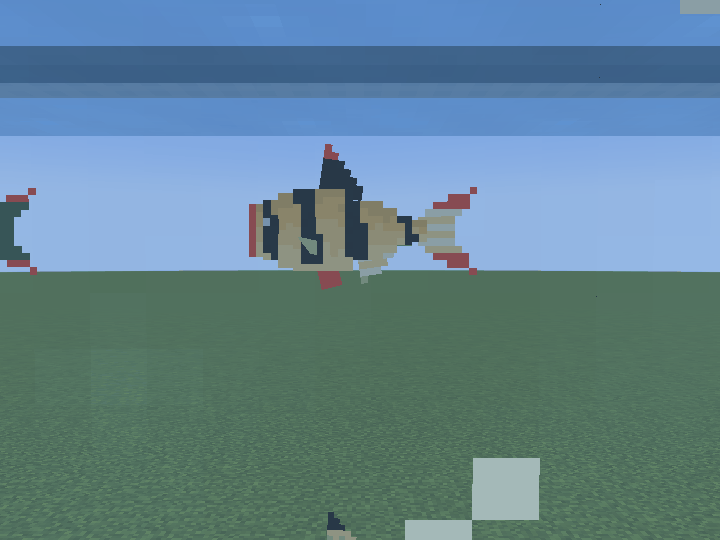

---
navigation:
  title: Tiger Barb
  icon: bettacraft:tiger_barb_bucket
  parent: tankmates/barbs.md
  position: 10
item_ids:
  - bettacraft:tiger_barb_bucket
  - bettacraft:tiger_barb_spawn_egg
---

# Tiger Barb

The classic barb: golden with four black bars, a red snout and red fin edges; lively and always in motion.

**Origin:** the rivers and swamps of Sumatra and Borneo.

## Profile

| | |
|---|---|
| Group | Barbs |
| Scientific name | *Puntigrus tetrazona* |
| Size in the game | about 6 cm (0.5 blocks) |
| Temperature | 20–28 °C |
| Breeding temperature | 24–27 °C |
| Water | fresh water, hardy |
| Water chemistry | pH 6.0–8.4, TDS 0–700 ppm |
| Shoal | from 6 fish |
| Swims | in the middle |
| Stocking | counts as 0.6 fish |
| Breeding | Scatters its eggs (fine plants, spawning mop), 30–80 young |
| Betta tank | no (nips fins) |
| Special | nips long fins, 3 colour varieties |

## Varieties

Varieties: Wild type, Green, Albino. The wild type is dominant, the bred varieties are recessive: only two equal alleles show the colour (carriers look wild). Of two different bred varieties the one listed first shows. Wild fish now and then carry a bred variety hidden; the menu shows the genes in a tooltip.

## Breeding

At 24–27 °C a pair scatters 30–80 eggs into fine-leaved plants, java moss or a **spawning mop**. The parents and every other fish eat the eggs they reach; in a spawning mop most are safe. Live food gets them ready faster.

## Keeping

* **Fin nipper:** goes for the long fins of bettas, angelfish, gouramis and male guppies (`tankmates.behaviour.finNipping`); in a shoal smaller than 6 twice as hard. Not with bettas.
* Hardy: 20–28 °C, tap water.

## Obtaining

* **[Aquarium net](../equipment/tank_net.md)** in rivers: 0.77–0.91 % per swing (about 1 in 110–130 swings), 1–4 at a time.
* **[Aquarium net](../equipment/tank_net.md)** in swamps: 0.79–0.93 % per swing (about 1 in 107–127 swings), 1–4 at a time.
* **Wild** in rivers, in groups of 3–6 (spawn weight 3) (config `features.barbsAndLoaches`).
* **Wild** in swamps, in groups of 3–6 (spawn weight 3) (config `features.barbsAndLoaches`).
* **Wandering trader** (usual offers): 6 for 5 emeralds; one of 25 in this offer.
* **[Breeding](breeding.md)**: Scatters its eggs (fine plants, spawning mop).

The biomes of biome mods count too ([biome tags](../settings.md)).
