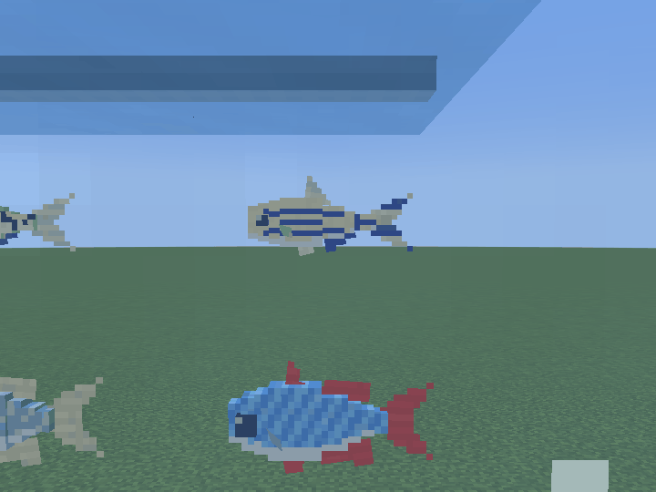

---
navigation:
  title: Zebra Danio
  icon: bettacraft:zebra_danio_bucket
  parent: tankmates/rasboras.md
  position: 30
item_ids:
  - bettacraft:zebra_danio_bucket
  - bettacraft:zebra_danio_spawn_egg
---

# Zebra Danio

A slim, fast shoaling fish with blue-black and silver-gold stripes from the gill to the tip of the tail; always busy at the surface.

**Origin:** the rivers, ditches and rice fields of India and Bangladesh.

## Profile

| | |
|---|---|
| Group | Rasboras |
| Scientific name | *Danio rerio* |
| Size in the game | about 5 cm (0.4 blocks) |
| Temperature | 18–27 °C |
| Breeding temperature | 24–27 °C |
| Water | fresh water, hardy |
| Water chemistry | pH 6.0–8.4, TDS 0–700 ppm |
| Shoal | from 6 fish |
| Swims | near the surface |
| Stocking | counts as 0.4 fish |
| Breeding | Scatters its eggs (fine plants, spawning mop), 30–80 young |
| Betta tank | too cool |
| Special | 3 colour varieties |

## Varieties

Varieties: Wild type, Leopard, Golden. The wild type is dominant, the bred varieties are recessive: only two equal alleles show the colour (carriers look wild). Of two different bred varieties the one listed first shows. Wild fish now and then carry a bred variety hidden; the menu shows the genes in a tooltip.

## Breeding

At 24–27 °C a pair scatters 30–80 eggs into fine-leaved plants, java moss or a **spawning mop**. The parents and every other fish eat the eggs they reach; in a spawning mop most are safe. Live food gets them ready faster.

## Keeping

* Very hardy: 18–27 °C, also in an unheated tank, tap water.
* Lively: calm fish like bettas can find it stressful in a small tank.

## Obtaining

* **[Aquarium net](../equipment/tank_net.md)** in rivers: 0.89–1.1 % per swing (about 1 in 95–113 swings), 1–4 at a time.
* **[Aquarium net](../equipment/tank_net.md)** in swamps: 0.5–0.59 % per swing (about 1 in 169–200 swings), 1–4 at a time.
* **Wild** in rivers, in groups of 3–6 (spawn weight 5) (config `features.tankmates.communityFish`).
* **Wild** in swamps, in groups of 3–6 (spawn weight 3) (config `features.tankmates.communityFish`).
* **Wandering trader** (usual offers): 6 for 4 emeralds; one of 36 in this offer.
* **[Breeding](breeding.md)**: Scatters its eggs (fine plants, spawning mop).

The biomes of biome mods count too ([biome tags](../settings.md)).
