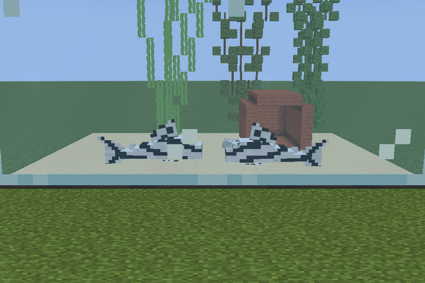

---
navigation:
  title: L046 Zebra Pleco
  icon: bettacraft:zebra_pleco_bucket
  parent: tankmates.md
  position: 21
item_ids:
  - bettacraft:zebra_pleco_bucket
  - bettacraft:zebra_pleco_spawn_egg
---

# L046 Zebra Pleco

Black and white stripes, very warm, clean water and a cave. Eats meaty food, not algae.

| | |
|---|---|
| Family | Plecos |
| Scientific | *Hypancistrus zebra (L046)* |
| Size in the game | about 7 cm (0.55 blocks) |
| Origin | the rocky rapids of the Rio Xingu in Brazil (protected in the wild) |
| Temperature | 26–31 °C |
| Shoal | alone or in pairs |
| Water | very sensitive |
| Stocking | 0.9 fish |
| Breeding | Spawns in a cave, the male guards, 28–31 °C |

## Breeding

Needs a **spawning cave** (decoration) and 28–31 °C. Every male claims a cave; a pair spawns 5–14 eggs in it and the male guards eggs and larvae until the young swim out. Without the male the clutch dies.

## Keeping

* Bottom fish: gets only part of the sinking food while faster fish are around - algae wafers go straight to it.
* Males defend their cave: give several males several caves.

## Getting it

With the [aquarium net](../invertebrates/catching.md) in jungle water and from the wandering trader (rare); then by breeding.
